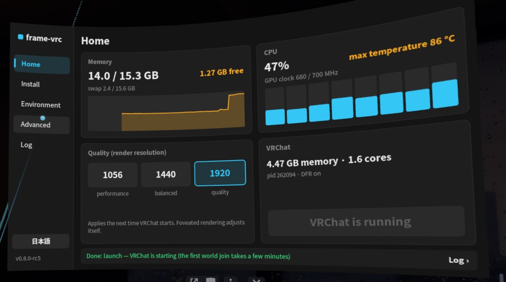

# frame-vrc

[English](README.md) · [中文](README.zh-CN.md) · **日本語**

**Steam Frame** 単体で **PC（Windows）版 VRChat**（EasyAntiCheat 対応）を動作させるツールです。

PC を使わず、ヘッドセットのターミナルからコマンド 1 つで導入でき、SteamVR ダッシュボードのパネルから公式 Android 版と PCVR 版をいつでもワンタップで切り替え・復元できます。



> [!IMPORTANT]
> **謝辞（[@ji10me](https://x.com/ji10me) 氏への感謝）：** 本プロジェクトの中核となる PCVR ランタイムは、すべて **ji10me 氏による [SteamFrame_Standalone_PCVR_VRChat](https://github.com/ji10me/SteamFrame_Standalone_PCVR_VRChat)** での多大な移植・開発成果（視線追跡による中心窩レンダリング DFR DXVK および視線追跡ブリッジ、H.264 ハードウェア動画デコード、Wine 音声修正、Vulkan Thunk 対応、スレッドスケジューリング最適化）に基づいています。当リポジトリは、その成果の上にヘッドセット単体でのインストーラーや VR パネルの統合、および軽微な調整・検証を加えたものです。**ji10me** 氏に深く感謝いたします。

> [!WARNING]
> **非公式ツール・自己責任でご利用ください。** Valve、VRChat、Epic Games とは一切関係ありません。本ツールは VRChat の Steam 互換性設定を変更し、ユーザーディレクトリ内に専用の Proton コピーとプライベート FEX 環境を追加します。EAC の回避や改変は行いませんが、非公式環境での利用は VRChat の利用規約に抵触し、アカウント処置の対象となる可能性があります。Steam、SteamVR、Proton、VRChat のアップデートにより動作しなくなる場合があります。Apache-2.0 ライセンスのもと、無保証で提供されます。

## クイックスタート

1. ヘッドセットの Konsole で通常ユーザー（`steamos`、**`sudo` は使用不可**）として以下を実行します：
   ```sh
   curl -fsSL https://raw.githubusercontent.com/HynoR/frame-vrc/main/get.sh | bash
   ```
2. SteamVR ダッシュボードの **+**（プログラムを起動）> **frame-vrc** を開きます。
3. **Setup to PCVR Version** をタップします（もう一度タップして確定）。
4. VRChat を起動すると、Steam が自動的に PC ビルドへ更新してから起動します。
5. 公式版に戻す場合は、パネルの **Recover to Official Android Version** をタップします。

## ドキュメント

- [画像付きチュートリアル](docs/tutorial.ja.md)
- [インストールとコマンド一覧](docs/install.ja.md)
- [変更内容とアンインストール](docs/changes.ja.md)
- [リリース履歴](docs/history.ja.md)

## 特徴

- **ヘッドセット単体で完結**：ダウンロード、検証、設定のすべてをヘッドセット上で行います。
- **環境の分離**：パッチ版 FEX は VRChat 専用のプライベート領域に配置され、Proton コピーも独立した互換ツールとして登録されます。システム領域や Steam 標準の FEX-Emu、他のゲームには影響しません。
- **メモリ制限に関する注意**：16 GB のシステムメモリのうち、SteamVR と Steam UI が約 7 GB を使用します。メモリ不足を防ぐため、VRChat 内のアバター表示制限や画質設定は低めに設定してください。

## ライセンスと謝辞

[Apache-2.0](LICENSE) ライセンスで提供されます。サードパーティ製コンポーネントのライセンスは [NOTICE](NOTICE) を参照してください。

- **[@ji10me](https://x.com/ji10me)**（[SteamFrame_Standalone_PCVR_VRChat](https://github.com/ji10me/SteamFrame_Standalone_PCVR_VRChat)）：PCVR ランタイム本体、[DFR DXVK](https://github.com/ji10me/dxvk-steam-frame-dfr) および視線追跡ブリッジ（ReinaS-64892 氏、poprox24 氏の成果に基づく）、H.264 動画プラグイン、Wine 音声修正、Vulkan thunk アダプター、セッション管理。
- [steamac](https://github.com/StonkGuy/steamac) および [StonkGuy/FEX](https://github.com/StonkGuy/FEX)（FX GAMES）：Proton 上で EAC を動作させるパッチ版 FEX。
- [FEX-Emu](https://github.com/FEX-Emu/FEX)、[DXVK](https://github.com/doitsujin/dxvk)、Mesa Turnip ドライバー、および Valve の Proton、EasyAntiCheat Runtime、SteamVR、OpenVR。
- [frameeyeosc](https://github.com/sasaken1102r/frameeyeosc) および FrameClash：VR パネルは FrameClash のパネル（MIT）をベースに作成。
- [Decky Loader](https://github.com/SteamDeckHomebrew/decky-loader)：Steam 起動オプションの設定手法。
