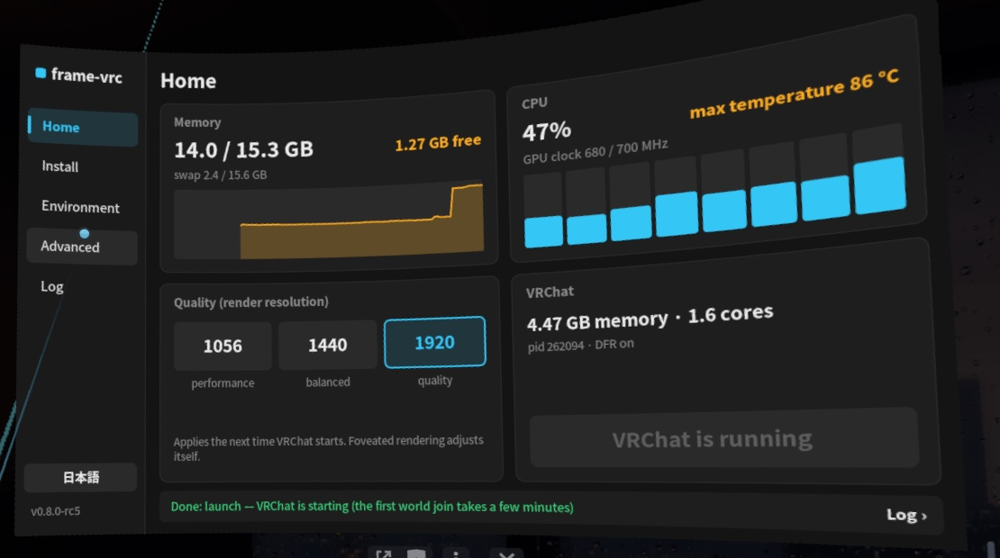

# frame-vrc

**English** · [中文](README.zh-CN.md) · [日本語](README.ja.md)

Run the **PC (Windows) version of VRChat** (with EasyAntiCheat) standalone on the **Steam Frame**.

Install directly on the headset with a single command in Konsole—no PC required—and use the SteamVR dashboard panel to switch between the official Android build and the PCVR build at any time.



> [!IMPORTANT]
> **Special Thanks to [@ji10me](https://x.com/ji10me):** All core PCVR runtime work comes from **ji10me's [SteamFrame_Standalone_PCVR_VRChat](https://github.com/ji10me/SteamFrame_Standalone_PCVR_VRChat)**—including eye-tracked foveated rendering (DFR DXVK & eye-tracking bridge), H.264 hardware video decoding, the Wine audio fix, Vulkan thunk adaptation, and VRChat thread scheduling. This repository only adds a small layer of headset-only packaging, VR panel integration, and testing on top of his foundational work.

> [!WARNING]
> **Unofficial tool—use at your own risk.** Not affiliated with or endorsed by Valve, VRChat, or Epic Games. This tool modifies VRChat's Steam compatibility settings and installs a standalone Proton copy and private FEX build in your home directory. While EAC is neither bypassed nor modified, running VRChat under an unofficial compatibility setup may violate VRChat's Terms of Service and could result in account action. Updates to Steam, SteamVR, Proton, or VRChat may break functionality at any time. Provided "as is" under the Apache-2.0 License, without warranty of any kind.

## Quick Start

1. Open Konsole on the headset as the normal user (`steamos`, **never use `sudo`**) and run:
   ```sh
   curl -fsSL https://raw.githubusercontent.com/HynoR/frame-vrc/main/get.sh | bash
   ```
2. In the SteamVR dashboard, tap **+** (Launch Program) > **frame-vrc**.
3. Tap **Setup to PCVR Version** (tap again to confirm).
4. Launch VRChat. Steam will automatically download the PC build before starting the game.
5. Tap **Recover to Official Android Version** in the panel at any time to switch back.

## Documentation

- [Step-by-Step Tutorial](docs/tutorial.md)
- [Installation & CLI Reference](docs/install.md)
- [System Changes & Uninstallation](docs/changes.md)
- [Release History](docs/history.md)

## Overview

- **Standalone Setup**: Downloads, verifies, and configures everything directly on the headset without a PC.
- **Isolated Environment**: The patched FEX build is scoped exclusively to VRChat, and the modified Proton build is registered as a separate compatibility tool. System packages, Steam's built-in FEX-Emu, and other games remain untouched.
- **Memory Constraints**: SteamVR and the Steam UI consume roughly 7 GB of the headset's 16 GB RAM. Keep VRChat's avatar limits and graphics settings low to avoid running out of memory.

## License & Acknowledgements

Licensed under [Apache-2.0](LICENSE). See [NOTICE](NOTICE) for third-party licenses and notices.

- **[@ji10me](https://x.com/ji10me)** ([SteamFrame_Standalone_PCVR_VRChat](https://github.com/ji10me/SteamFrame_Standalone_PCVR_VRChat)): Core PCVR runtime, [DFR DXVK](https://github.com/ji10me/dxvk-steam-frame-dfr) and eye-tracking bridge (building on work by ReinaS-64892 and poprox24), H.264 video plugin, Wine audio fix, Vulkan thunk adapter, and session supervisor.
- [steamac](https://github.com/StonkGuy/steamac) and [StonkGuy/FEX](https://github.com/StonkGuy/FEX) (FX GAMES): Patched FEX enabling EAC under Proton.
- [FEX-Emu](https://github.com/FEX-Emu/FEX), [DXVK](https://github.com/doitsujin/dxvk), Mesa Turnip driver, and Valve's Proton, EasyAntiCheat Runtime, SteamVR, and OpenVR.
- [frameeyeosc](https://github.com/sasaken1102r/frameeyeosc) and FrameClash: VR dashboard panel adapted from FrameClash (MIT).
- [Decky Loader](https://github.com/SteamDeckHomebrew/decky-loader): Approach for configuring Steam launch options.
