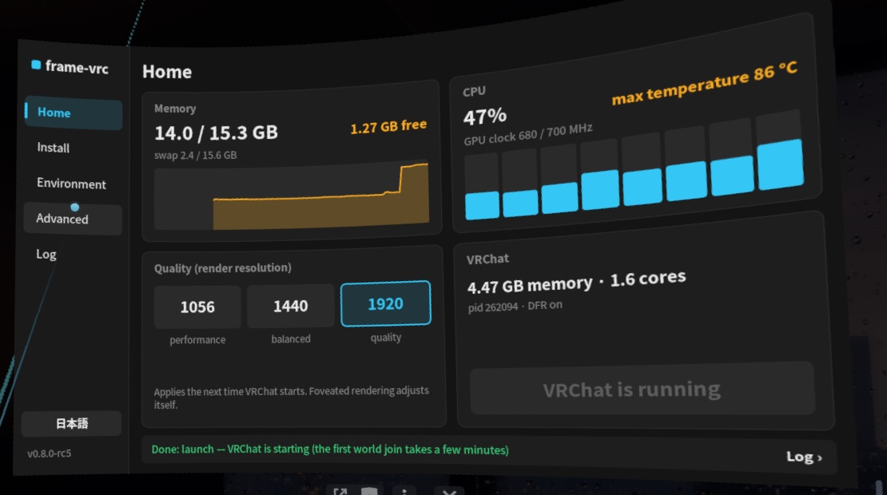

# frame-vrc

[English](README.md) · **中文** · [日本語](README.ja.md)

在 **Steam Frame** 头显上独立运行 **PC（Windows）版 VRChat**（支持 EasyAntiCheat）。

无需连接电脑，直接在头显终端执行一条命令即可完成安装，并通过 SteamVR 面板在官方安卓版与 PCVR 版之间一键切换或完整还原。



> [!IMPORTANT]
> **核心致谢：** 本项目的核心运行方案完全基于 **[@ji10me](https://x.com/ji10me)** 在 **[SteamFrame_Standalone_PCVR_VRChat](https://github.com/ji10me/SteamFrame_Standalone_PCVR_VRChat)** 中的杰出适配与开源贡献（包括眼动注视点渲染 DFR DXVK、眼动追踪桥接、H.264 硬件视频解码、Wine 音频修复、Vulkan Thunk 适配及线程调度优化）。本仓库仅在此基础上做了少量的免 PC 安装封装、VR 面板集成与测试工作。特此向 **ji10me** 致以诚挚感谢！

> [!WARNING]
> **非官方工具，风险自负。** 本项目与 Valve、VRChat、Epic Games 无关。工具会修改 VRChat 的 Steam 兼容性设置，并在用户目录安装独立的 Proton 副本与私有 FEX 环境。虽然未修改或绕过 EAC，但使用非官方兼容层仍可能违反 VRChat 服务条款并导致账号处罚。Steam、SteamVR、Proton 或 VRChat 更新均可能导致功能失效。本项目按 Apache-2.0 许可证“原样”提供，不提供任何担保。

## 快速开始

1. 在头显的 Konsole 终端中以普通用户（`steamos`，**勿用 `sudo`**）运行：
   ```sh
   curl -fsSL https://raw.githubusercontent.com/HynoR/frame-vrc/main/get.sh | bash
   ```
2. 在 SteamVR 仪表板上点 **+**（启动程序）> **frame-vrc**。
3. 点击 **Setup to PCVR Version**（再次点击确认）。
4. 启动 VRChat，等待 Steam 自动更新为 PC 版本。
5. 如需切回官方版本，随时在面板中点击 **Recover to Official Android Version**。

## 文档

- [图文安装教程](docs/tutorial.zh-CN.md)
- [安装与命令说明](docs/install.zh-CN.md)
- [文件变更与卸载还原](docs/changes.zh-CN.md)
- [版本历史](docs/history.zh-CN.md)

## 特性说明

- **免 PC 安装**：全程在头显本地完成下载、校验与配置。
- **环境隔离**：补丁版 FEX 仅安装于 VRChat 私有目录，Proton 副本作为独立兼容工具注册，不影响系统自带的 FEX-Emu 及其他游戏。
- **内存占用提示**：头显总内存为 16 GB（SteamVR 与系统界面常驻占用约 7 GB），建议在 VRChat 内调低模型显示限制与画质设置以防内存耗尽。

## 许可与致谢

本项目基于 [Apache-2.0](LICENSE) 许可发布，第三方组件许可详见 [NOTICE](NOTICE)。

- **[@ji10me](https://x.com/ji10me)**（[SteamFrame_Standalone_PCVR_VRChat](https://github.com/ji10me/SteamFrame_Standalone_PCVR_VRChat)）：提供核心 PCVR 运行方案、[DFR DXVK](https://github.com/ji10me/dxvk-steam-frame-dfr) 与眼动追踪桥接（基于 ReinaS-64892 与 poprox24 的成果）、H.264 硬件解码插件、Wine 音频修复、Vulkan thunk 适配及会话管理。
- [steamac](https://github.com/StonkGuy/steamac) 与 [StonkGuy/FEX](https://github.com/StonkGuy/FEX)（FX GAMES）：提供支持 Proton 下运行 EAC 的补丁版 FEX。
- [FEX-Emu](https://github.com/FEX-Emu/FEX)、[DXVK](https://github.com/doitsujin/dxvk)、Mesa Turnip 驱动，以及 Valve 的 Proton、EasyAntiCheat Runtime、SteamVR 与 OpenVR。
- [frameeyeosc](https://github.com/sasaken1102r/frameeyeosc) 与 FrameClash：VR 面板基于 FrameClash 面板（MIT）改造。
- [Decky Loader](https://github.com/SteamDeckHomebrew/decky-loader)：Steam 启动参数配置方法参考。
