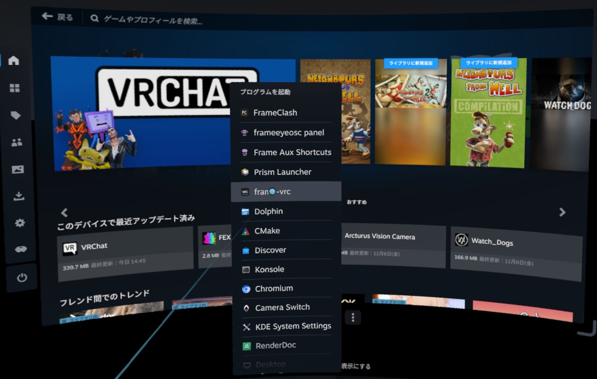
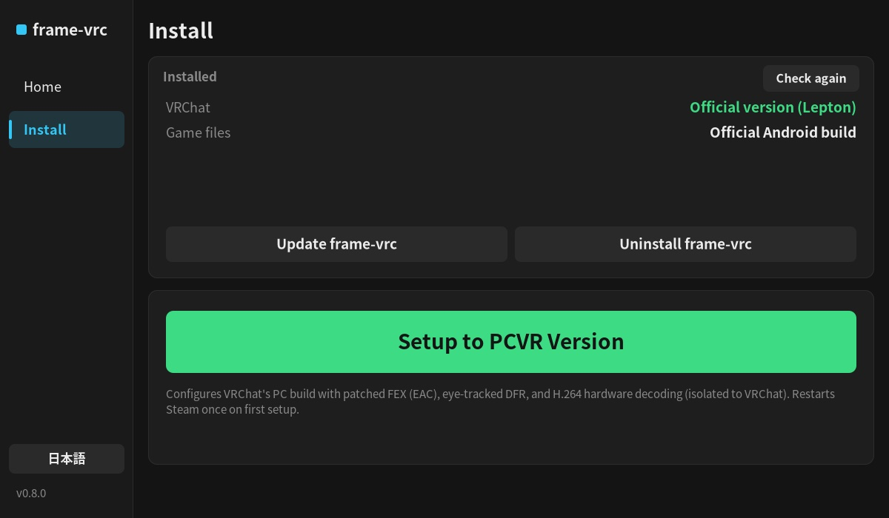
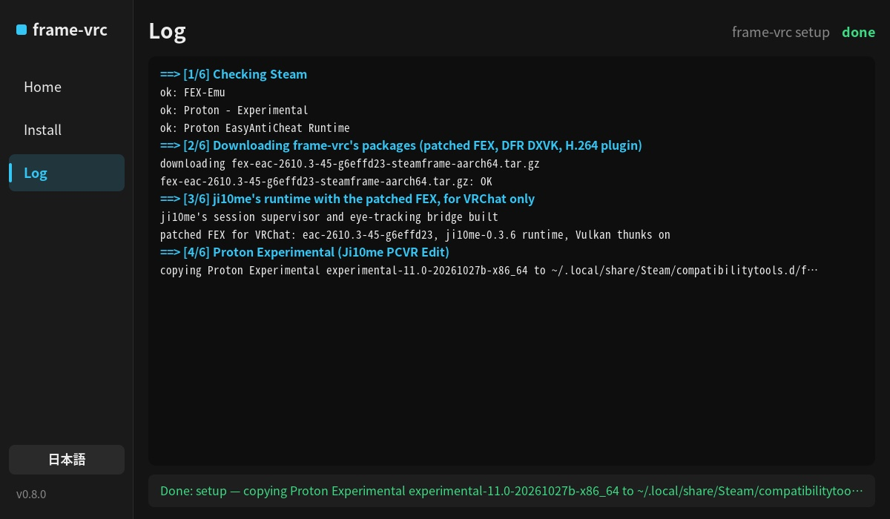
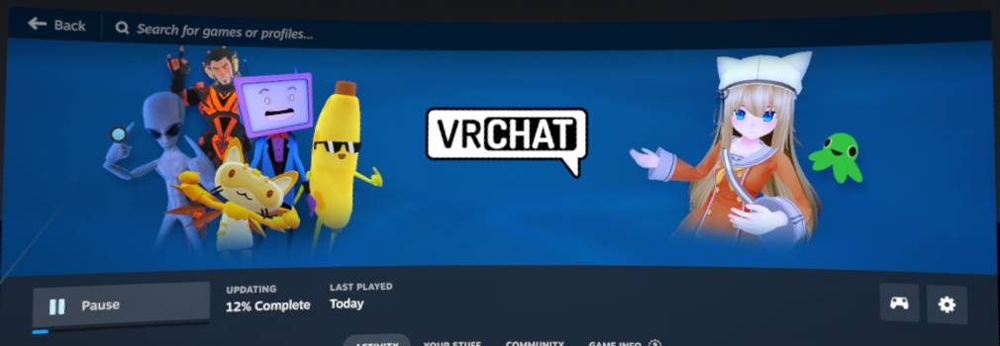
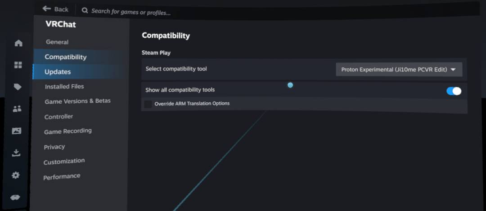
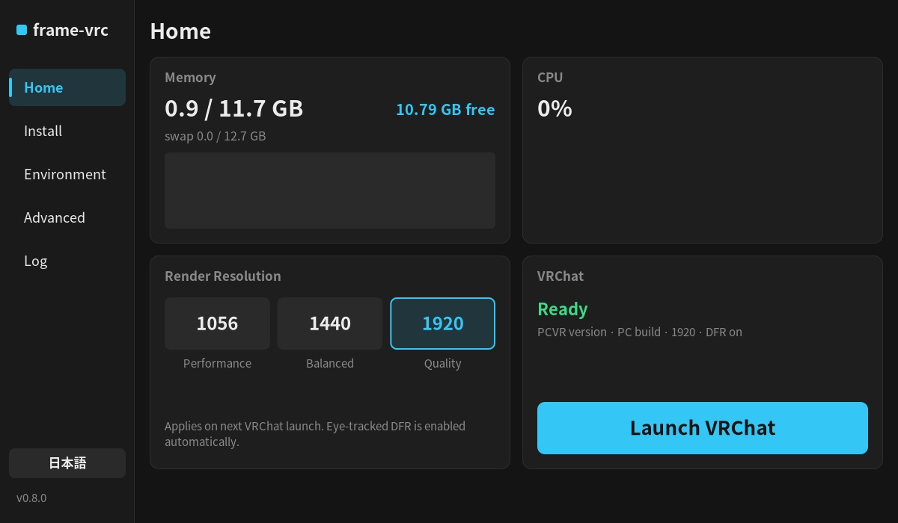
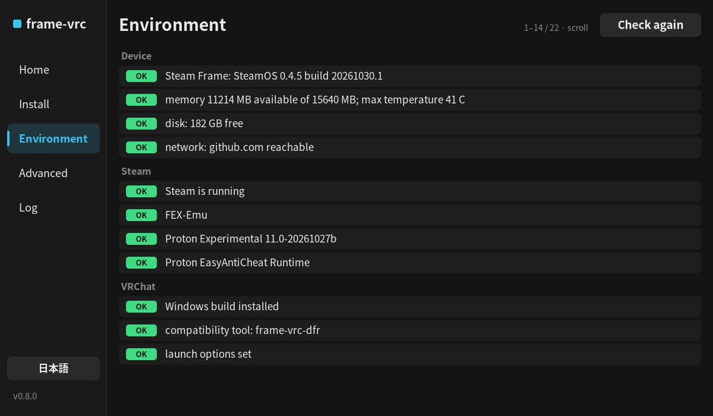
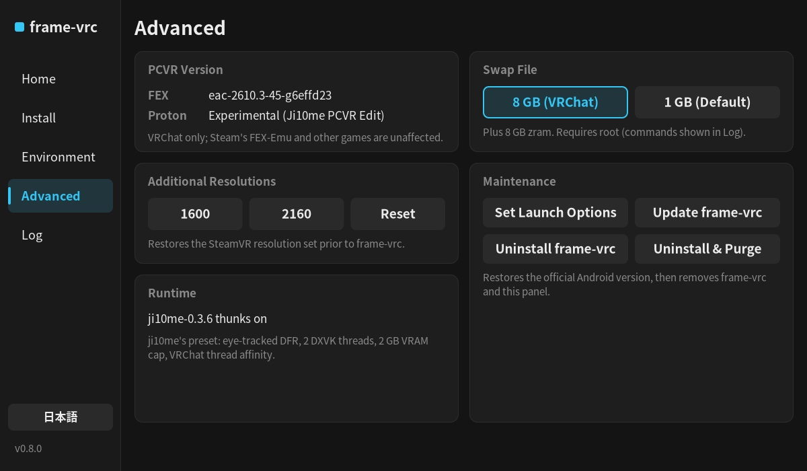
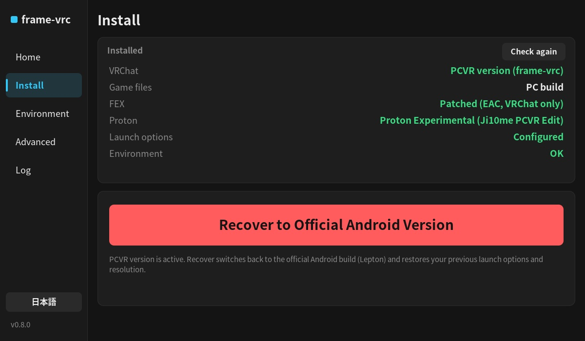
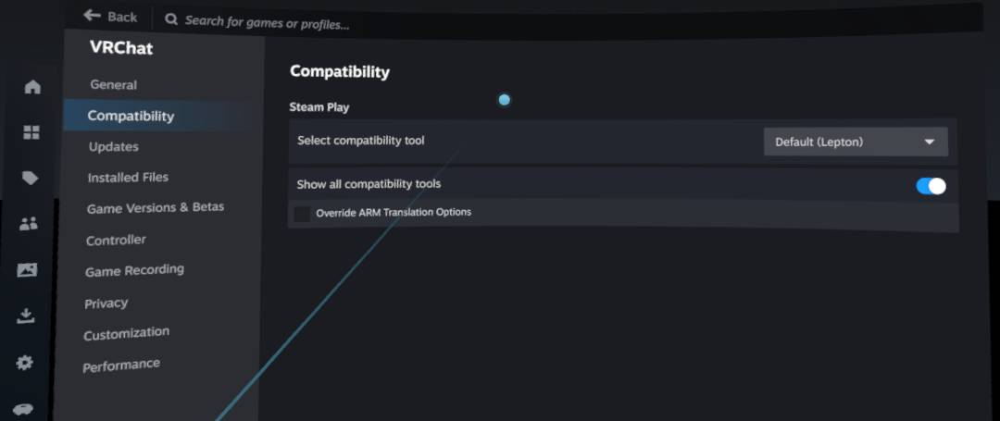

# インストール・利用チュートリアル

[English](tutorial.md) · [中文](tutorial.zh-CN.md) · **日本語**

Steam Frame に `frame-vrc` を導入し、PC 版 VRChat（EasyAntiCheat 対応）を起動するまでの手順を説明します。所要時間は約 10 分です（別途約 1.1 GB のゲーム更新が必要です）。事前に [README](../README.ja.md) の免責事項をご確認ください。

## バージョン切り替えの仕組み

`frame-vrc` は Steam の互換ツール設定を変更することで VRChat のバージョンを切り替えます：

| バージョン | Steam 互換ツール |
|---|---|
| **公式版**（Android ビルド） | デフォルト（Lepton） |
| **PCVR 版**（Windows ビルド + DFR + H.264 ハードウェア動画） | Proton Experimental (Ji10me PCVR Edit) |

VRChat の起動時に、選択されている互換ツールに対応するビルドへ Steam が自動更新します。パッチ版 FEX は VRChat 専用環境として分離されており、Steam 標準の FEX-Emu や他のゲームには影響しません。

## 1. frame-vrc のインストール

ヘッドセットの Konsole（または SSH）で、通常ユーザー `steamos` として以下のコマンドを実行します（**`sudo` は使用しないでください**）：

```sh
curl -fsSL https://raw.githubusercontent.com/HynoR/frame-vrc/main/get.sh | bash
```

約 1 分で完了します。完了後、SteamVR ダッシュボードの **+**（プログラムを起動）> **frame-vrc** から VR パネルを開きます。



## 2. PCVR 版のセットアップ

パネルの **Install** ページを開きます：



1. **Setup to PCVR Version**（緑）をタップし、もう一度タップして確定します。
2. 初回実行時は、追加した互換ツールを認識させるため **Steam が 1 回自動再起動**します（画面が約 1 分間消えた後、自動的にセットアップが再開されます）。進行状況は **Log** ページで確認できます。
3. VRChat が未インストールの場合は Steam のインストール画面が表示されるため、確定してください。



完了すると、パネルに **patched: update and launch VRChat** と表示されます。

## 3. VRChat の起動

パネルの **Home** ページまたは Steam から VRChat を起動します。初回は PC ビルド（約 1.1 GB）のダウンロードが行われた後に起動します。最初のワールド入室時はシェーダー処理のため数分かかりますが、2 回目以降は高速になります。



**VRChat > プロパティ > 互換性** で設定内容を確認できます（起動オプションは自動で `frame-vrc-run %command%` に設定されます。手動で変更しないでください）：



## 4. パネルの各ページ

左下の言語ボタンで English / 日本語 を切り替えられます。VRChat が未インストールまたは公式版の状態では **Home** と **Install** のみ表示され、PCVR 版に切り替えると全ページが表示されます：

- **Home**：メモリ・CPU 使用率、描画解像度（`1056` / `1440` / `1920`、既定値 `1920`）、**Launch VRChat** ボタン。中心窩レンダリング（DFR）と H.264 ハードウェアデコードは常時有効です。

  

- **Environment**：動作環境のチェック項目一覧。問題がある項目には修復ボタンが表示されます。

  

- **Advanced**：導入済みコンポーネントのバージョン、追加の解像度設定、スワップ状態、アップデート・アンインストール操作。

  

## 5. 公式 Android 版に戻す

**Install** ページで **Recover to Official Android Version**（赤）をタップし、もう一度タップして確定します。互換ツールがデフォルト（Lepton）に戻り、元の起動オプションと解像度設定が復元されます。次回起動時に Steam が Android ビルドを再ダウンロードします。





## コマンドライン操作

パネルの全機能はコマンドラインからも実行できます：

```text
frame-vrc setup | official | status | doctor
frame-vrc resolution 1056|1440|1920
frame-vrc launch | update | uninstall [--purge]
```

詳細は [インストールとコマンド一覧](install.ja.md) および [変更内容とアンインストール](changes.ja.md) を参照してください。
