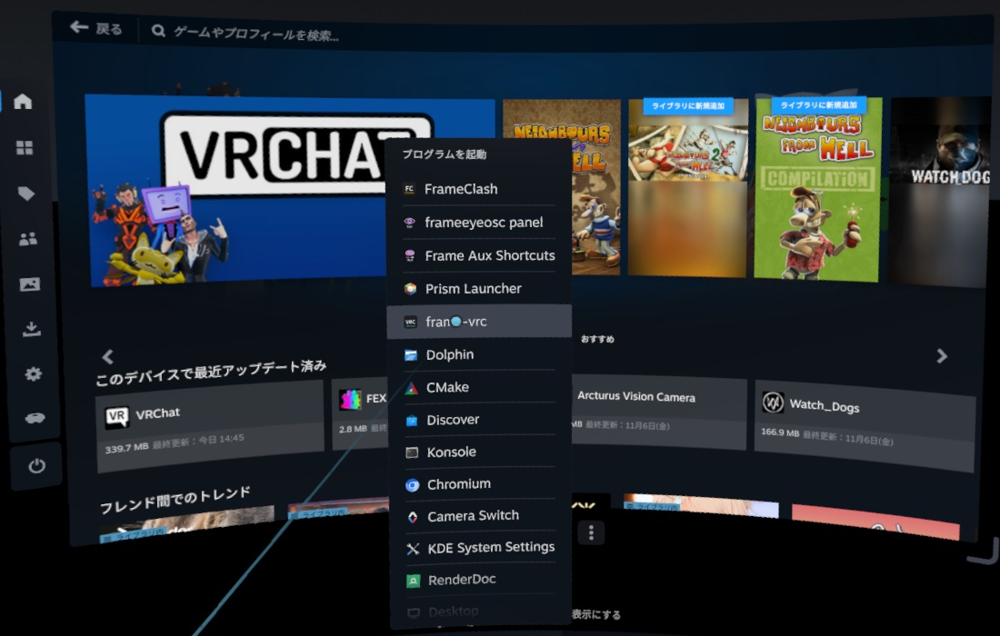
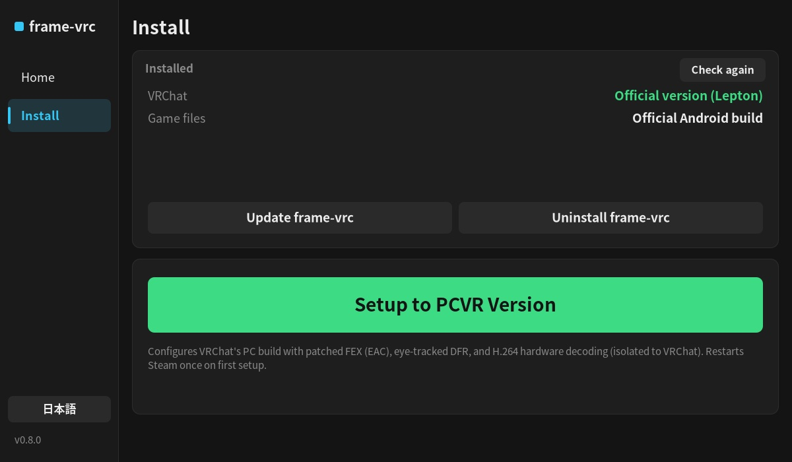
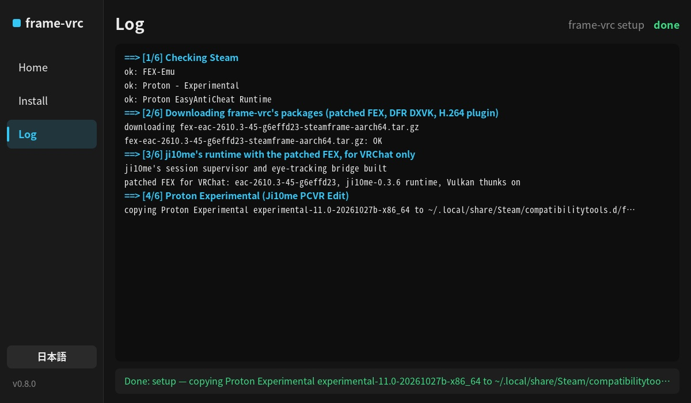
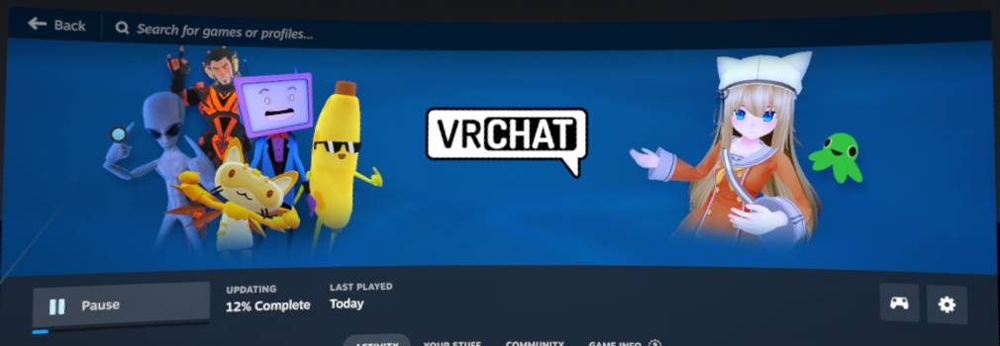
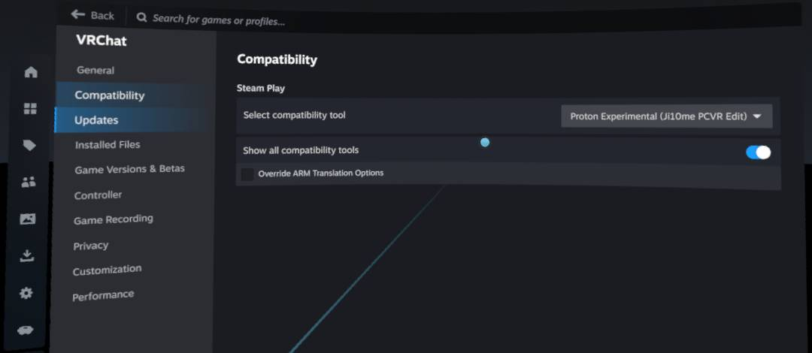
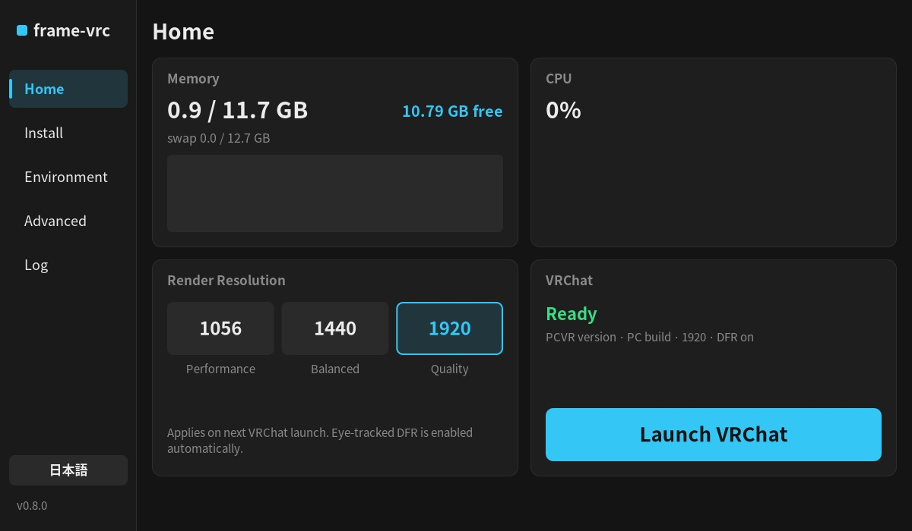
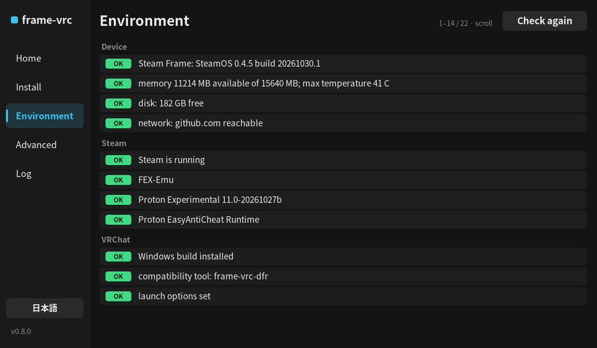
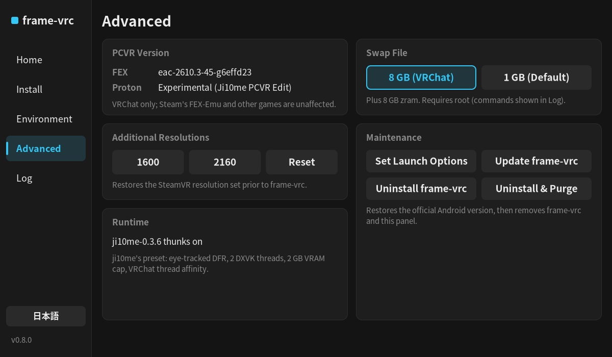
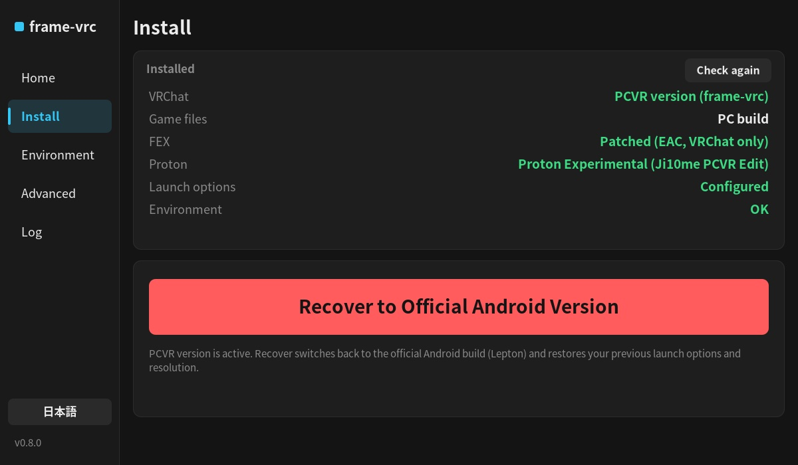
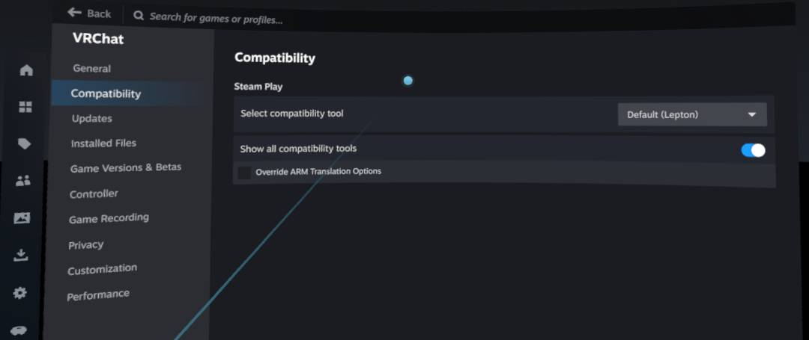

# Step-by-Step Tutorial

**English** · [中文](tutorial.zh-CN.md) · [日本語](tutorial.ja.md)

This guide walks through installing `frame-vrc` and running the PC version of VRChat (with EasyAntiCheat) on the Steam Frame. Setup takes about 10 minutes, plus a ~1.1 GB game update. Please read the disclaimer in the [README](../README.md) before proceeding.

## How Version Switching Works

`frame-vrc` switches between VRChat builds by configuring VRChat's Steam compatibility tool:

| Version | Steam Compatibility Tool |
|---|---|
| **Official** (Android build) | Default (Lepton) |
| **PCVR** (Windows build + DFR + H.264 hardware video) | Proton Experimental (Ji10me PCVR Edit) |

When you launch VRChat, Steam automatically updates the game to match the selected compatibility tool. The patched FEX environment is isolated to VRChat and does not affect Steam's built-in FEX-Emu or other games.

## 1. Install frame-vrc

In Konsole on the headset (or over SSH), run the following command as the normal user `steamos` (**never use `sudo`**):

```sh
curl -fsSL https://raw.githubusercontent.com/HynoR/frame-vrc/main/get.sh | bash
```

Installation takes about a minute. Once complete, open the VR panel: in the SteamVR dashboard, tap **+** (Launch Program) > **frame-vrc**.



## 2. Configure the PCVR Version

Open the **Install** page in the panel:



1. Tap **Setup to PCVR Version** (green), then tap again to confirm.
2. On first run, **Steam will restart once** to register the new compatibility tool (the dashboard will disappear for about a minute before resuming setup automatically). You can monitor progress on the **Log** page.
3. If VRChat is not yet installed, confirm Steam's installation prompt when it appears.



Once finished, the panel status will show **patched: update and launch VRChat**.

## 3. Launch VRChat

Launch VRChat from the panel's **Home** page or from Steam. Steam will download the PC build (~1.1 GB) before starting the game. Joining your first world takes a few minutes for initial shader compilation; subsequent loads will be much faster.



Under **VRChat > Properties > Compatibility**, you can verify the configured compatibility tool (launch options are automatically set to `frame-vrc-run %command%`—do not edit them manually):



## 4. Panel Overview

Use the language button in the bottom-left corner to switch between English and 日本語. When VRChat is uninstalled or set to the official Android build, only **Home** and **Install** are shown; switching to the PCVR version unlocks all pages:

- **Home**: Displays memory/CPU usage, render resolution presets (`1056` / `1440` / `1920`, default `1920`), and **Launch VRChat**. Eye-tracked foveated rendering (DFR) and H.264 hardware decoding are always enabled.

  

- **Environment**: Lists environment health checks with one-tap fix buttons for any detected issues.

  

- **Advanced**: Shows installed component versions, additional resolution options, swap status, update, and uninstall controls.

  

## 5. Switch Back to the Official Version

On the **Install** page, tap **Recover to Official Android Version** (red) and tap again to confirm. VRChat will revert to Lepton along with your previous launch options and resolution. Steam will download the Android build the next time you launch VRChat.





## Command-Line Interface

All panel actions are also available via the CLI:

```text
frame-vrc setup | official | status | doctor
frame-vrc resolution 1056|1440|1920
frame-vrc launch | update | uninstall [--purge]
```

See [Installation & CLI Reference](install.md) and [System Changes & Uninstallation](changes.md) for full details.
