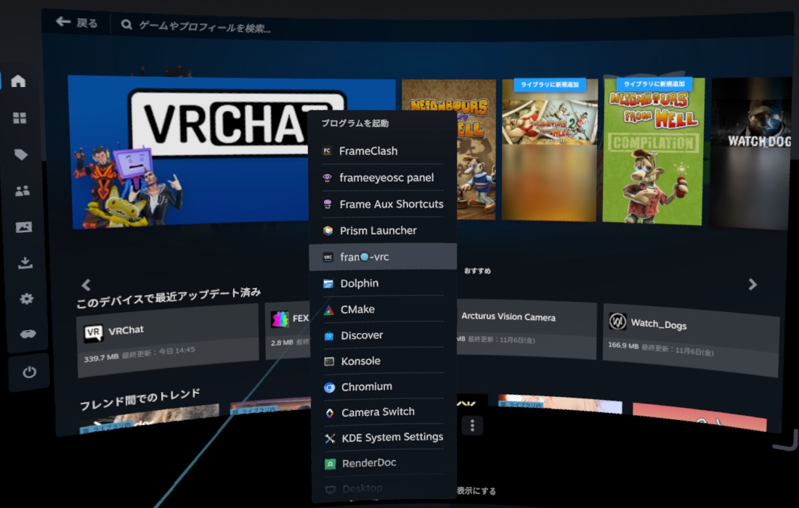
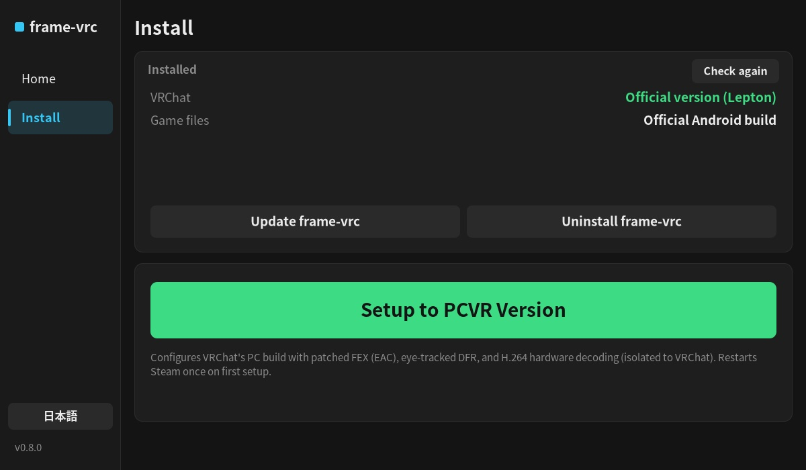
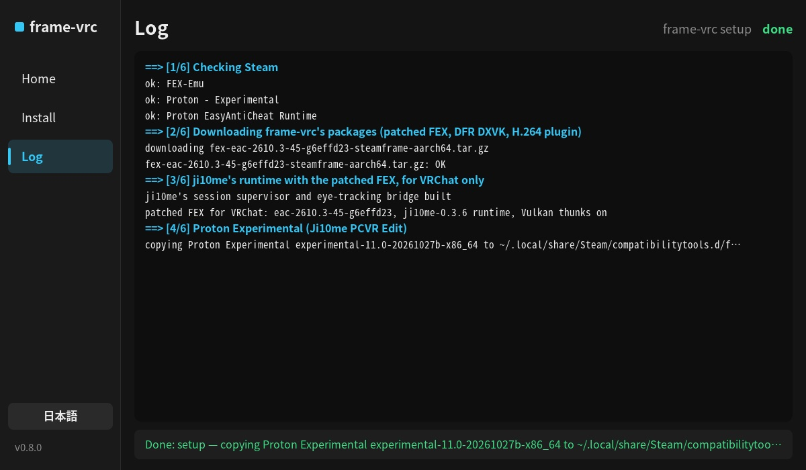
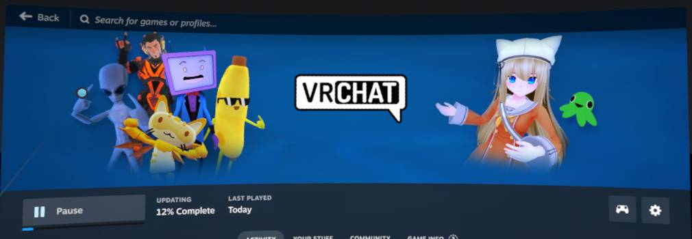
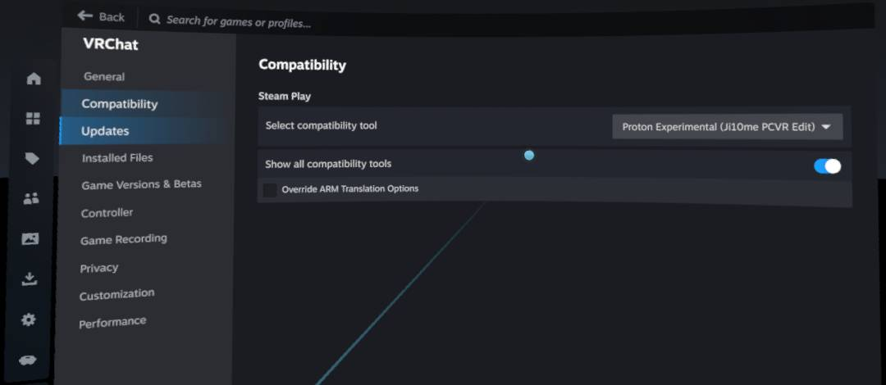
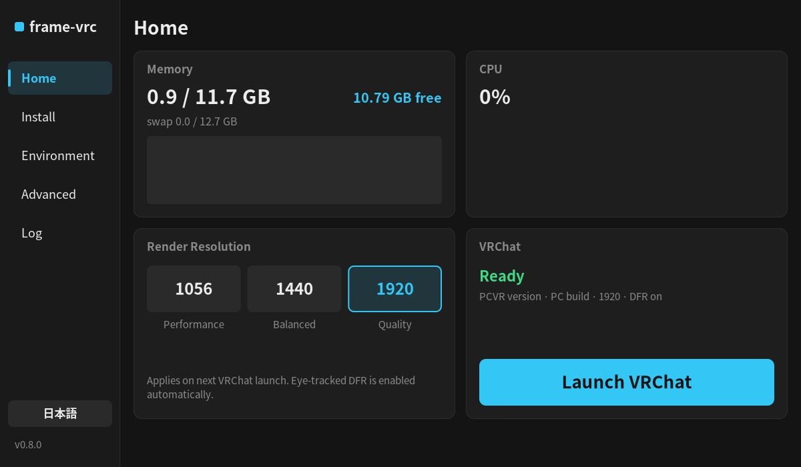
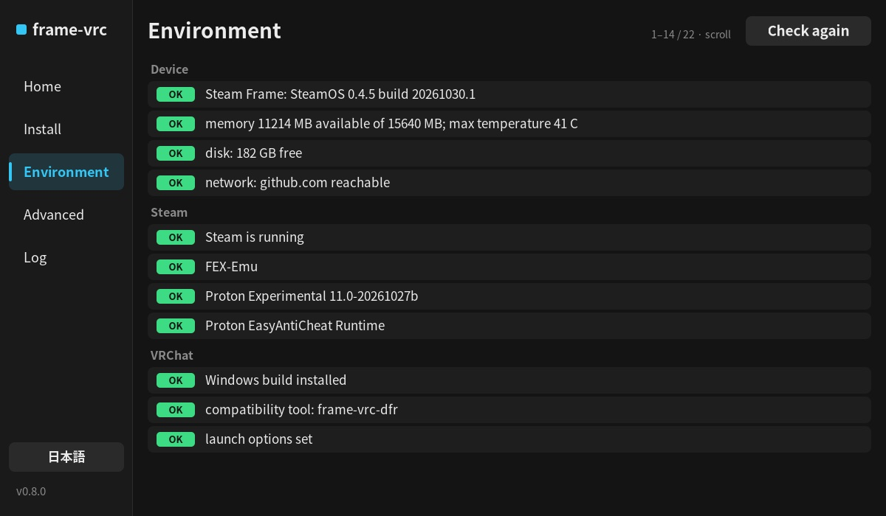
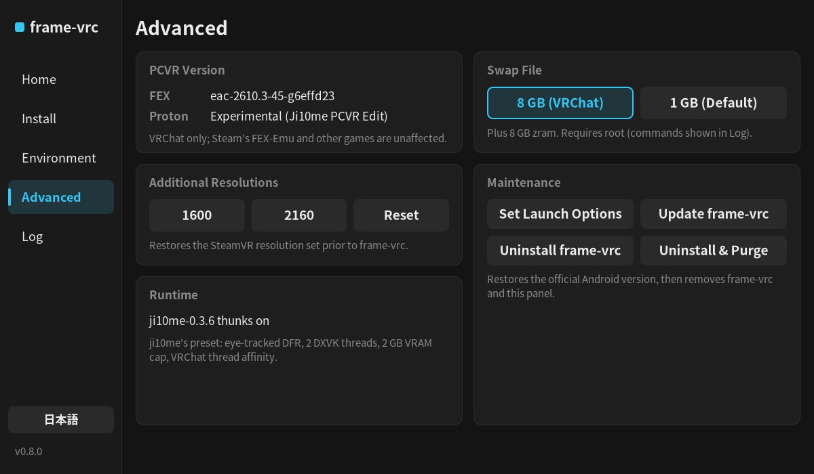
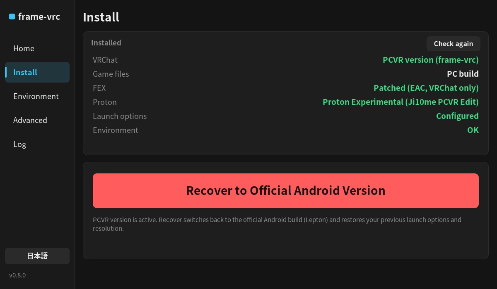
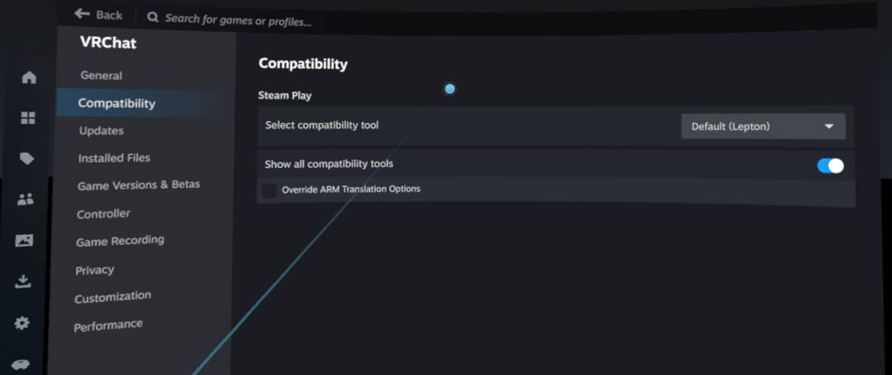

# 安装与使用教程

[English](tutorial.md) · **中文** · [日本語](tutorial.ja.md)

本教程介绍如何在 Steam Frame 上安装 `frame-vrc` 并运行 PC 版 VRChat（含 EasyAntiCheat）。全程耗时约 10 分钟（另需下载约 1.1 GB 的游戏更新）。使用前请先阅读 [README](../README.zh-CN.md) 中的免责声明。

## 版本切换原理

`frame-vrc` 通过配置 Steam 的兼容工具来切换 VRChat 版本：

| 版本 | Steam 兼容工具 |
|---|---|
| **官方版**（安卓构建） | 默认（Lepton） |
| **PCVR 版**（Windows 构建 + DFR + H.264 硬件解码） | Proton Experimental (Ji10me PCVR Edit) |

切换版本后，下次启动 VRChat 时 Steam 会自动下载并更新为对应平台的构建。补丁版 FEX 仅对 VRChat 生效，不影响系统自带的 FEX-Emu 及其他游戏。

## 1. 安装 frame-vrc

在头显的 Konsole 终端（或通过 SSH）中，以普通用户 `steamos` 执行以下命令（**请勿使用 `sudo`**）：

```sh
curl -fsSL https://raw.githubusercontent.com/HynoR/frame-vrc/main/get.sh | bash
```

安装耗时约 1 分钟。完成后打开 VR 面板：在 SteamVR 仪表板上点 **+**（启动程序）> **frame-vrc**。



## 2. 配置 PCVR 版

进入面板的 **Install** 页面：



1. 点击 **Setup to PCVR Version**（绿色按钮），再次点击确认。**Install** 页面会进入 8 步配置向导（可随时点击 **View log** 查看原始输出）。
2. 缺失的 Steam 工具（FEX-Emu、Proton Experimental、Proton EasyAntiCheat Runtime）会**逐个**弹出安装确认；若不小心关掉弹窗，点击 **Reopen Install Prompt** 可重新打开当前项。Steam 下载期间向导会自动等待。
3. 到第 7 步时，如需让 Steam 识别新的兼容工具，会**自动重启一次 Steam**（界面会短暂消失，重新打开面板后自动恢复当前进度）。
4. 若某一步失败或中途停止，点击 **Retry This Step**（或重新运行 `frame-vrc setup`）即可从该步继续。



配置完成后，若 VRChat 本体仍需在 Steam 中下载或更新为 PC 版，向导会提示需在 Steam 中安装或更新 VRChat（或显示 **patched: update and launch VRChat**）。

## 3. 启动 VRChat

从面板 **Home** 页或 Steam 库中启动 VRChat。Steam 会先下载 PC 版本更新（约 1.1 GB），随后启动游戏。首次进入世界需要编译着色器，耗时数分钟，后续进入会明显加快。



配置完成后，VRChat 的“属性 > 兼容性”设置如下（启动参数会自动设为 `frame-vrc-run %command%`，请勿手动修改）：



## 4. 面板功能说明

面板左下角可切换界面语言（English / 日本語）。当 VRChat 未安装或处于官方版时，仅显示 **Home** 与 **Install** 页面；切换至 PCVR 版后将显示完整页面：

- **Home**：查看内存与 CPU 占用、调整单眼渲染分辨率（`1056` / `1440` / `1920`，默认 `1920`）以及启动 VRChat。注视点渲染（DFR）与 H.264 硬件解码默认常开。

  

- **Environment**：展示各项运行环境检查结果，异常项会提供一键修复按钮。

  

- **Advanced**：查看已安装组件版本、更多分辨率档位、Swap 状态，以及执行更新或卸载。

  

## 5. 切回官方安卓版

在 **Install** 页面点击 **Recover to Official Android Version**（红色按钮）并再次点击确认。兼容工具将恢复为默认的 Lepton，并还原原有的启动参数与渲染分辨率。下次启动 VRChat 时，Steam 会自动下载回安卓版。





## 命令行工具

面板的所有操作均可通过终端命令完成：

```text
frame-vrc setup | official | status | doctor
frame-vrc resolution 1056|1440|1920
frame-vrc launch | update | uninstall [--purge]
```

更多说明详见 [安装与命令说明](install.zh-CN.md) 与 [文件变更与卸载还原](changes.zh-CN.md)。
